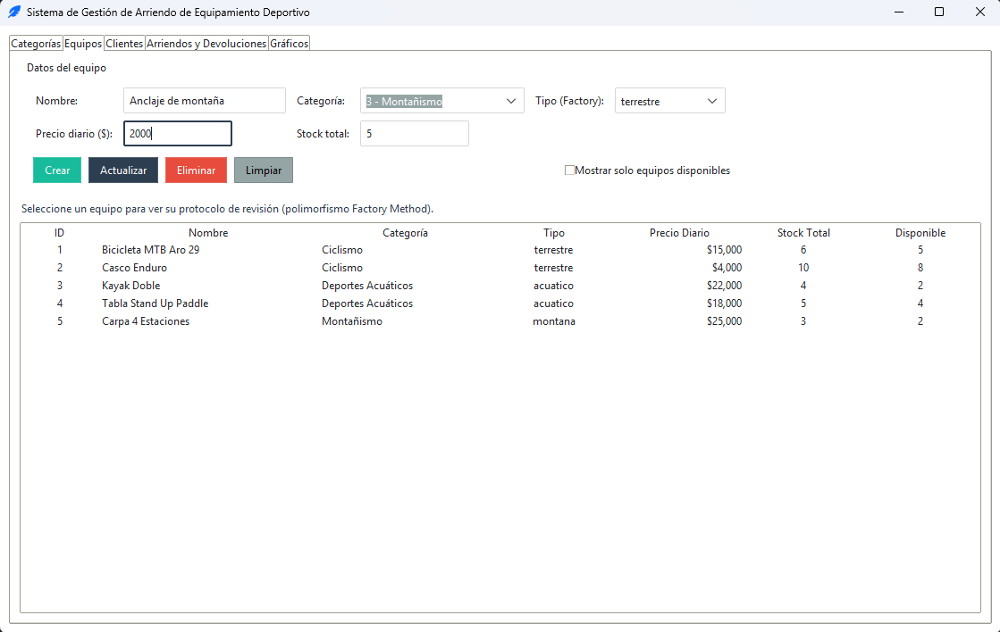
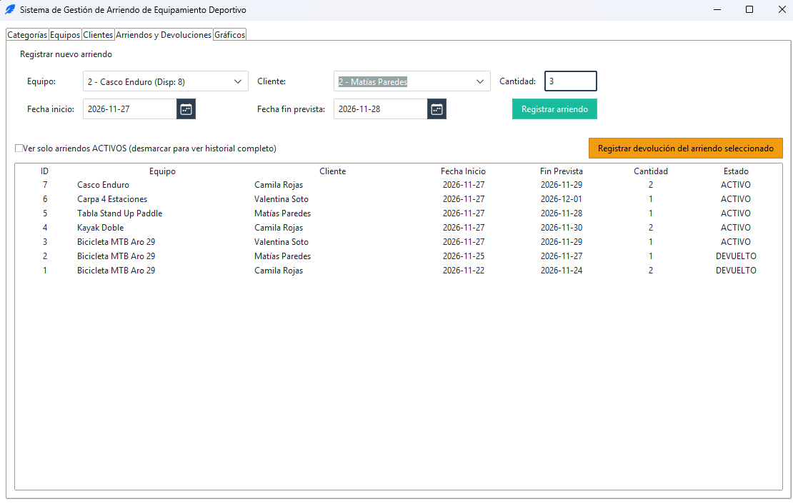
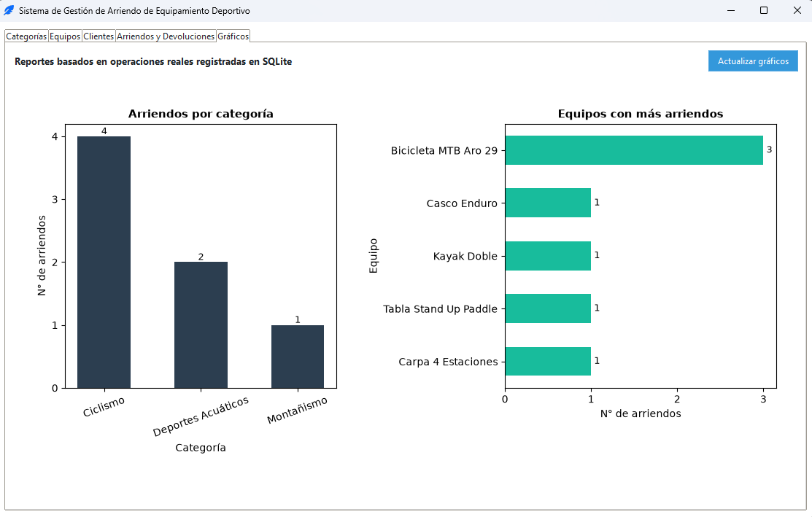
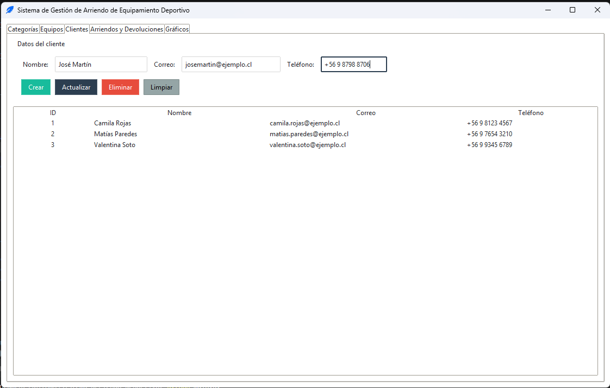
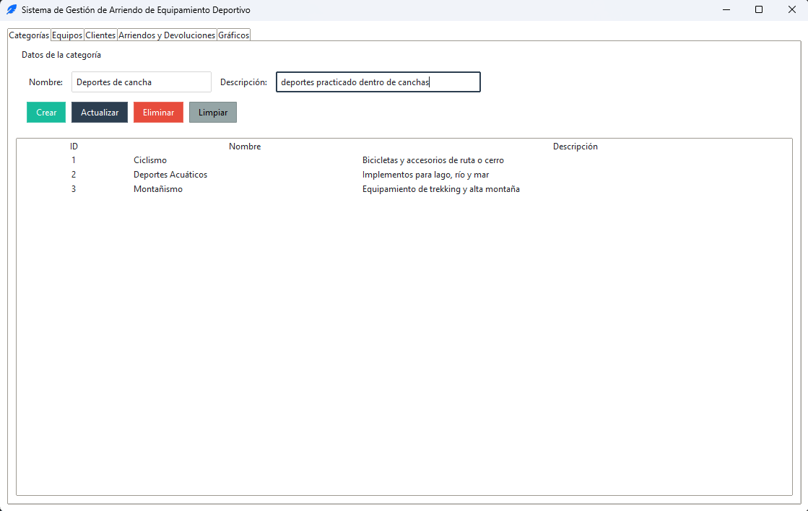

# Sistema de Gestión de Arriendo de Equipamiento Deportivo

Aplicacion desarrollada en Python para **Programación II (Universidad Católica de Temuco)** Permite administrar categorías, equipos y clientes registrar arriendos con control transaccional de stock y procesar devoluciones y visualizar métricas mediante gráficos estadísticos

## Tecnologías utilizadas

* **Python 3**
* **SQLAlchemy ORM** (sintaxis declarativa clásica con sesiones transaccionales)
* **SQLite** (persistencia local con llaves foráneas activas mediante `PRAGMA foreign_keys=ON`)
* **Tkinter + ttkbootstrap** (interfaz gráfica de escritorio con pestañas, formularios, tablas y selector de fechas)
* **Matplotlib** (gráficos incrustados mediante `FigureCanvasTkAgg`)

## Estructura del proyecto

```text
├── main.py              # Punto de entrada de la aplicación
├── database.py          # Conexión SQLite, activación de FK y sesión SQLAlchemy
├── models.py            # Entidades ORM, restricciones CHECK y herencia de tabla única
├── factory.py           # Implementación del patrón Factory Method (GoF)
├── services.py          # Operaciones CRUD, validaciones y transacciones atómicas
├── charts.py            # Generación de los 2 gráficos Matplotlib desde BD
├── ui.py                # Interfaz gráfica en Tkinter / ttkbootstrap
├── seed.py              # Script para poblar la base de datos con datos de ejemplo
├── requirements.txt     # Dependencias del proyecto
└── capturas/            # Capturas de pantalla de la aplicación
```

## Modelo de datos

| Entidad | Atributos principales | Relaciones y restricciones |
| **Categoria** | `id`, `nombre` (único), `descripcion` | Una categoría tiene muchos equipos (1:N). No eliminable si tiene equipos asociados. |
| **Equipo** | `id`, `nombre`, `categoria_id`, `precio_diario` (>0), `stock_total` (>=0), `stock_disponible` (>=0, <= total), `tipo_equipo` | Pertenece a una categoría; tiene muchos arriendos. Implementa herencia de tabla única (*Single Table Inheritance*). |
| **Cliente** | `id`, `nombre`, `correo` (único), `telefono` | Un cliente puede tener muchos arriendos (1:N). No eliminable si tiene arriendos registrados. |
| **Arriendo** | `id`, `equipo_id`, `cliente_id`, `fecha_inicio`, `fecha_fin_prevista` (>= inicio), `cantidad` (>0), `estado` (`ACTIVO` / `DEVUELTO`) | Pertenece a un equipo y a un cliente. |

## Integración del patrón Factory Method

Para diferenciar la clasificación comercial (`Categoria`) del comportamiento técnico de cada implemento, se aplicó el patrón **Factory Method** junto con **herencia de tabla única (Single Table Inheritance)** en SQLAlchemy:

* **Productos:** la clase base `Equipo` define el método polimórfico `protocolo_revision()`, sobreescrito por tres subclases persistentes (`EquipoTerrestre`, `EquipoAcuatico` y `EquipoMontana`), almacenadas en la misma tabla `equipos` mediante la columna discriminadora `tipo_equipo`.
* **Creadores:** la clase abstracta `CreadorEquipo` declara el método fábrica `crear_equipo(...)`, implementado por `CreadorEquipoTerrestre`, `CreadorEquipoAcuatico` y `CreadorEquipoMontana`.
* **Utilidad:** desacopla la creación de equipos desde la capa de servicios/interfaz, facilita agregar nuevos tipos respetando el principio Abierto/Cerrado y permite que al consultar o devolver un equipo desde SQLite, SQLAlchemy reconstruya automáticamente la subclase correcta y ejecute su protocolo de revisión específico.

## Instalación y ejecución

1. **Clonar el repositorio y entrar a la carpeta:**
   ```bash
   git clone https://github.com/sub-dll/sistema-arriendo-deportivo
   ```
   ```bash
   cd sistema-arriendo-deportivo
   ```

2. **Crear y activar un entorno virtual:**
   ```bash
   python -m venv venv
   .\venv\Scripts\activate
   ```
   *(En Linux/macOS: `source venv/bin/activate`)*

3. **Instalar dependencias:**
   ```bash
   pip install -r requirements.txt
   ```


4. **Generar base de datos de ejemplo (opcional, deja ver los graficos de inmediato pero si quiere ver como se crean uno por uno primero, abra sin bd):**
   ```bash
   python seed.py
   ```


5. **Ejecutar la aplicación:**
   ```bash
   python main.py
   ```


## Pruebas mínimas verificadas

| Paso | Acción ejecutada | Resultado verificado |
| :---: | :--- | :--- |
| 1 | Crear categoría y equipo con stock total `5` | Se crea con `stock_disponible = 5` mediante Factory Method |
| 2 | Crear cliente y registrar arriendo de `2` unidades | `stock_disponible` baja a `3` y el arriendo queda en estado `ACTIVO` dentro de la misma transacción |
| 3 | Intentar arrendar `4` unidades adicionales | Operación rechazada con mensaje de stock insuficiente; stock permanece en `3` |
| 4 | Registrar devolución del arriendo de `2` unidades | `stock_disponible` vuelve a `5`, estado cambia a `DEVUELTO` y se muestra el protocolo de revisión del tipo de equipo |
| 5 | Intentar devolver nuevamente el mismo arriendo | Operación rechazada por devolución duplicada; stock permanece en `5` |
| 6 | Cerrar y reabrir la aplicación y abrir la pestaña Gráficos | Persistencia confirmada en SQLite y ambos gráficos generados desde los arriendos reales |

Adicionalmente se verificó el rechazo de fechas de término anteriores a la fecha de inicio y el bloqueo al intentar eliminar categorías, equipos o clientes con registros vinculados.

## Capturas de pantalla

### Gestión de Equipos y protocolo polimórfico (Factory Method)


### Gestión de Arriendos y Devoluciones


### Gráficos Matplotlib incrustados


### Pestaña Clientes


### Pestaña Categorias


## Fuentes consultadas

* **Tkinter (documentación oficial de Python):** https://docs.python.org/es/3/library/tkinter.html
* **ttkbootstrap (temas modernos y `DateEntry` para Tkinter):** https://ttkbootstrap.readthedocs.io/
* **Matplotlib (incrustación de figuras en Tkinter con `FigureCanvasTkAgg`):** https://matplotlib.org/stable/gallery/user_interfaces/embedding_in_tk_sgskip.html
* **Patrón Factory Method (estructura GoF y aplicabilidad):** https://refactoring.guru/es/design-patterns/factory-method
* **SQLAlchemy ORM (mapeo declarativo y herencia de tabla única):** https://docs.sqlalchemy.org/en/20/orm/inheritance.html
